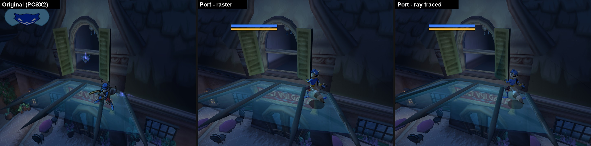
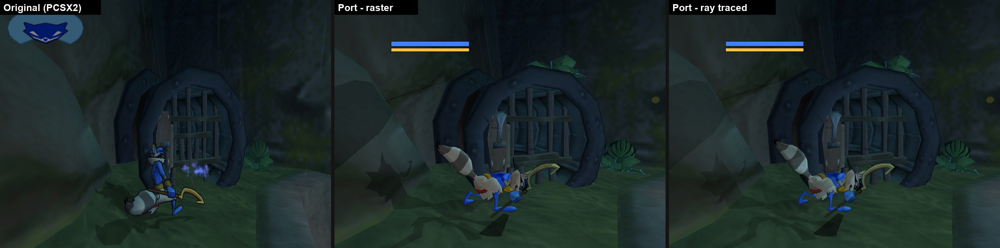
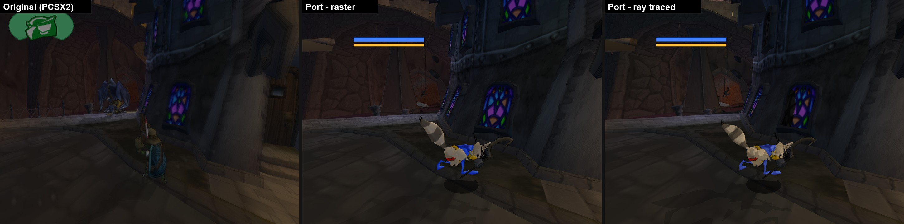
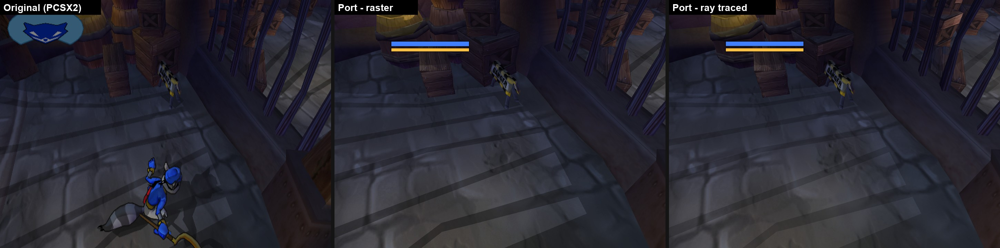
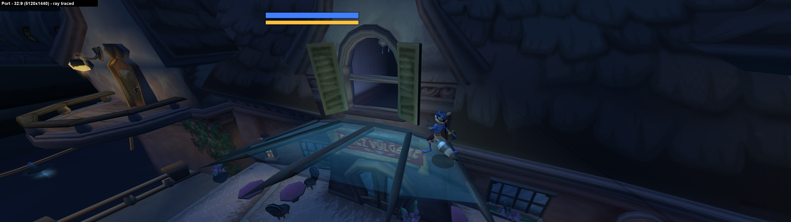
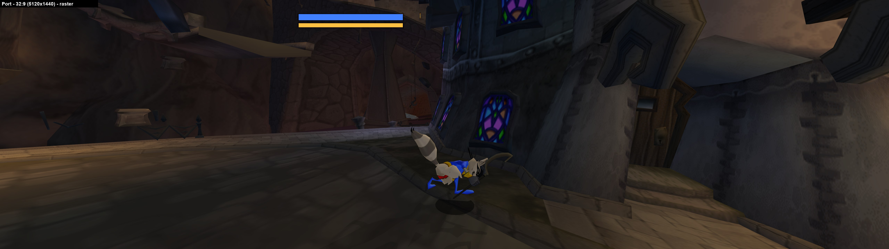

# 🦝 Sly 2: Bevy of Thieves

> ## ⛔ ABANDONED (October 2026)
>
> This project has been **stopped and is no longer maintained**. The repository is archived (read-only) and
> published as-is, so anyone who wants to pick up the pieces can fork it. Issues and pull requests will not
> be answered.
>
> **State at the end:** EP1 and EP2 hubs load and run; the player controller, collision solver and Splice
> script VM are largely ported and many EP1 missions are wired, but nothing is playable start to finish. Many
> behaviour fixes sit behind `SLY2_*` environment-variable opt-outs, and a number of them were tuned to match
> PCSX2 captures without the original mechanism being confirmed.
>
> **Why it stopped:** a hand-written 1:1 port *into Bevy* turned out to be the expensive route. Sly 2's own
> engine (C++ objects and vtables, scheduler, physics solver, script interpreter) had to be rebuilt inside
> Bevy, which contributed little, and most of the time went into chasing frame-level differences against
> emulator captures. If you want to continue the idea, a **matching decompilation** (like the Sly 1 decomp)
> or a **static recompilation** (like the N64 recomp projects) is probably the better-value path.
>
> Everything below is the README as it stood during development.

### *Sly, Rewritten.* A Rust + Bevy rewrite of *Sly 2: Band of Thieves*.

> *"The Cooper Gang never steals from honest folk. They only steal from the PS2."*

**Sly 2: Bevy of Thieves** is a fan-made, from-scratch **rewrite of Sly 2: Band of Thieves in Rust, running on
the [Bevy](https://bevyengine.org/) engine**. It is not an emulator and it is not a recompiled binary wrapped
in a PS2 runtime: the game's logic is ported 1:1 into Rust, function by function, and everything the PS2
hardware used to do (rendering, audio, input, memory cards) is rebuilt natively on Bevy.

Think of it as **the Code Heist**: we cased the joint (decompiled the original), planned the job
(Bentley-approved, of course), and now we're lifting the game out of the PS2 one function at a time and
stashing it in a modern engine, without breaking any of the original's quirks on the way out.

> **⚠ Early Access: the heist is still in progress.** **Episode 1 is not fully playable yet.** Levels load
> and you can sneak Sly around, but many objects, jobs, cutscenes and menus are incomplete or missing.
> Expect bugs, crashes and visual glitches. Carmelita is still on our tail.

**No game assets are included.** This repository is pure code, no loot. Every game file (levels, models,
textures, sounds, videos, scripts and text) is read at run time from **your own disc image**.

## The Job So Far (progress)

As of 2026-10-19:

| Metric | | What it means |
|---|---|---|
| **Ported** | **97.7 %** | Share of the original game's EE functions rewritten in Rust (6362 total; partial ports count half) |
| **Wired** | **68.0 %** | Share of that ported code hooked into the running game |
| **Playable** | **88 %** | Episode 1 release checklist: 12 of 16 items pass, the other 4 (later mission rows) are partial |

## Screenshots

Original (PCSX2) on the left, then Bevy of Thieves with raster lighting, then with ray-traced global
illumination. Each set is captured from the same savestate, so the camera and Sly's position match.
Work in progress: the HUD is still a placeholder, and some effects and poses don't match yet.

**Episode 1: Paris, Hotel Vulgaire**


**Episode 3: hub**


**Episode 4: hub**


**Episode 1: cellar**


**32:9 ultrawide (5120x1440), ray traced**: a wider view, not stretched




## Why a rewrite, not a recompile?

PS2 "recomps" translate the original machine code into C/C++ automatically and run it on a layer that imitates
PS2 hardware. That's fast to make, but the game still renders through an imitation PS2 graphics chip.

Bevy of Thieves goes further: the game's real 3D scene, lights, camera and data live in a modern engine.
That's what makes these possible:

- **Global ray-traced illumination** (Bevy Solari) as a normal graphics option. Raster lighting is the
  default and always available. Requires a build with feature `rt` and a ray-tracing capable GPU.
- **Ultrawide up to 32:9**: Hor+ (constant vertical FOV, wider view, no stretching); the HUD stays centred in
  a 16:9 safe area. More room to spot the guards before they spot you.
- **Easy mods**: `mods/<name>/` folders overlay disc files, levels, textures and sounds by path, with a load
  order file. See [bevy_of_thieves/mods/README.md](bevy_of_thieves/mods/README.md). Every good thief needs a
  disguise.
- Keyboard + mouse and gamepads, fully rebindable (`controls.toml`).

## What works

- Reads the original ISO directly (ISO 9660, level descriptors, LZ-compressed level streams); nothing is
  extracted to disk.
- Boot flow: intro movie (PSS/MPEG-2 playback), title screen, menus, save/load (memory card files on disk).
- All 43 level files load: geometry, textures/CLUTs, lighting, Sly's animations and movement, camera,
  collision, guards and many object classes, HUD, text/fonts, sound effects and music.
- Character switching (Sly / Bentley / Murray, rebindable).
- The Splice script VM and its built-in functions drive level logic.

Still being cracked: complete jobs, many object behaviours, several cutscenes and menus. See
`bevy_of_thieves/` and its tests for the current scope.

## Requirements (your heist kit)

- Rust (stable, edition 2024) with `cargo`.
- A disc image of *Sly 2: Band of Thieves* (USA, `SCUS-97316`) dumped from **your own** disc:
  `Sly 2 - Band of Thieves (USA).iso`.
- A GPU supported by Bevy/wgpu (Vulkan, DX12 or Metal). Ray tracing needs hardware RT support.

## Build

```sh
cd bevy_of_thieves
cargo build --release --features game        # raster only
cargo build --release --features game,rt     # + ray-traced global illumination option
```

The executable is `bevy_of_thieves/target/release/game(.exe)`.

## Run

```sh
cargo run --release --features game --bin game -- "path/to/Sly 2 - Band of Thieves (USA).iso"
```

ISO lookup order: the command-line path, then `iso` in `settings.toml`, then
`Sly 2 - Band of Thieves (USA).iso` next to the executable.

Developer options: `--level <static-table row>` / `--table <level-table row>` start directly in a level;
`--width W --height H` set the window size; `--screenshot out.png --frames N` capture a frame and exit.

## Controls (defaults)

| PS2 | Keyboard / mouse | Gamepad |
|---|---|---|
| Left stick | W A S D | Left stick |
| Right stick (camera) | I J K L | Right stick |
| Cross (jump) | Space | South (A) |
| Circle | E | East (B) |
| Square (attack) | Q / left mouse | West (X) |
| Triangle | F | North (Y) |
| L1 / R1 | Left Shift / right mouse | LB / RB |
| L2 / R2 | Z / C | LT / RT |
| L3 / R3 | Left Ctrl / middle mouse | stick clicks |
| Start / Select | Esc or Enter / Tab | Start / Select |
| D-pad | arrow keys | D-pad |

Rebind in `controls.toml` next to the executable (written with the defaults on first run).

## Settings

`settings.toml` next to the executable (written on first run; see
[bevy_of_thieves/settings.example.toml](bevy_of_thieves/settings.example.toml)): ISO path, resolution,
fullscreen, vsync, Hor+, `global_illumination = "off" | "raytraced"`, ink outlines, volumes and the mod load
order. Most options are also in the in-game options menu.

## Tests

```sh
cd bevy_of_thieves
cargo test --release                         # fast tier
cargo test --release -- --include-ignored    # full tier (heavy all-level tests)
```

All tests are modules of one test binary (`tests/all/`, with shared helpers in `tests/all/common.rs`).

Most tests read the game from `Sly 2 - Band of Thieves (USA).iso` in the repository root (next to
`bevy_of_thieves/`); put your ISO (or a link to it) there. The ISO is git-ignored.

## Join the Gang (contributing)

Issues and pull requests are welcome. Ground rules for the crew:

- Port game code 1:1 (same behaviour and quirks), named after the original function and commented with its
  address (`// 0x001b3bd0`). PS2 platform code (GS/VU/DMA, IOP, PS2 SDK) is replaced by Bevy equivalents.
- Never commit game data: no ISO, ELF, extracted files, decompiled code or copyrighted screenshots. We're
  master thieves, not pirates.
- `cargo build --release --features game` and `cargo test --release` must pass. Do not run `cargo fmt` on the
  whole tree (some tables are hand-formatted).

Note: the library crate is still named `sly2_recomp` internally (from the project's early days); the package
is `bevy_of_thieves`. A full internal rename is planned.

## License

Code is MIT licensed (see [LICENSE](LICENSE)). The license does not cover the game or its assets.

## Legal

This is an unofficial fan project, **not affiliated with or endorsed by Sucker Punch Productions or Sony
Interactive Entertainment**. *Sly Cooper* and *Sly 2: Band of Thieves* are trademarks of Sony Interactive
Entertainment. No copyrighted game data is distributed with this project; you must use a disc image you
dumped yourself from a legally owned copy of the game.
